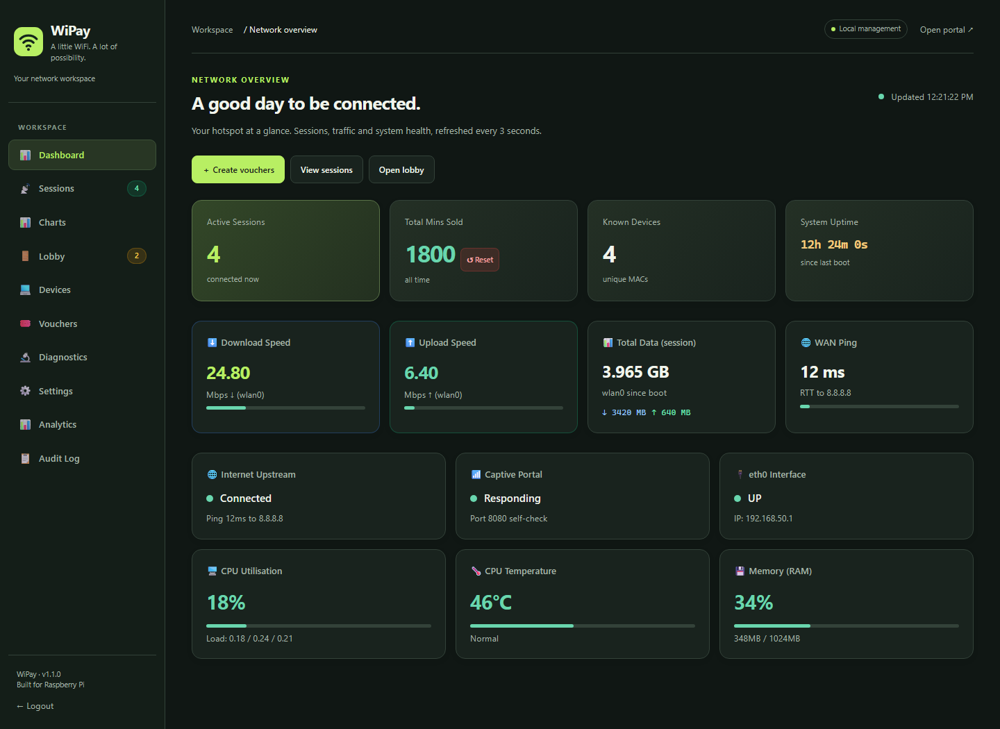
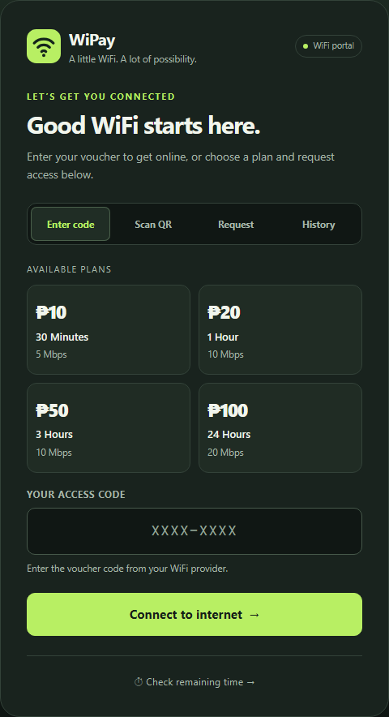
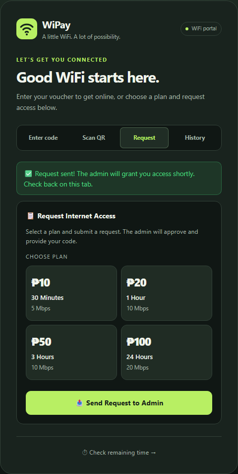
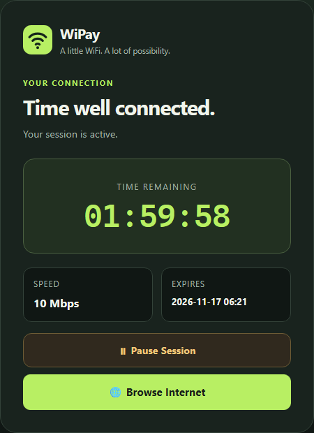
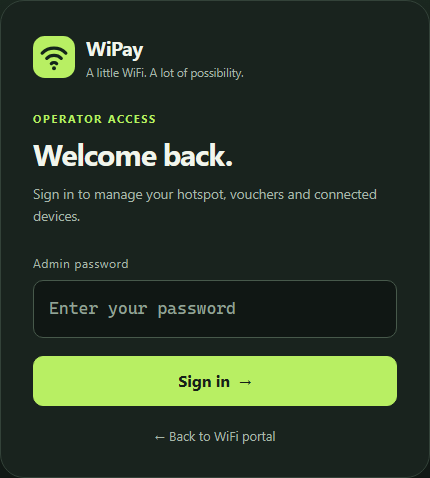

<div align="center">


# WiPay

**Good WiFi starts here. A voucher-based captive portal and hotspot dashboard for Raspberry Pi.**

[](https://github.com/Rohan-Reyes/WIPAY/releases/latest)
[](SETUP_GUIDE)
[](requirements.txt)
[](LICENSE)

[**Download WiPay**](https://github.com/Rohan-Reyes/WIPAY/releases/latest) · [Setup guide](SETUP_GUIDE) · [What's new](CHANGELOG.md)



</div>

## Why WiPay

- **Your hotspot, your rules.** Give customers timed access with vouchers, configurable plans, speed caps and optional session pausing.
- **Made for the local network.** Vouchers, devices and settings live in SQLite on your Pi. The interface, chart library and QR decoder are served locally.
- **One place to run things.** Create vouchers, approve access requests and see connected devices, traffic and system health from a responsive dashboard.

## Screenshots

<table>
  <tr>
    <td align="center"><br><sub><b>Connect</b><br>Enter a voucher or choose a plan</sub></td>
    <td align="center"><br><sub><b>Request</b><br>Ask the operator for access</sub></td>
    <td align="center"><br><sub><b>Session</b><br>Check time, pause and resume</sub></td>
    <td align="center"><br><sub><b>Manage</b><br>A dedicated operator sign in</sub></td>
  </tr>
</table>

<sub>Real application screens with fictional sample data and simulated network metrics. Preview tools never configure your firewall.</sub>

## Features

| | |
|---|---|
| **Voucher access** | Generate individual or bulk vouchers with duration, speed and QR codes. Export or import vouchers as CSV. |
| **Customer portal** | Enter a code, scan a QR voucher, request a plan or revisit device history. Selecting a plan fills the request form. |
| **Session control** | Live countdowns, optional pause/resume, time adjustments and manual revocation. |
| **Access requests** | A lobby queue where operators approve requests and issue access codes. |
| **Device management** | Device names, blocking, whitelisting, groups, bandwidth profiles and configurable data quotas. |
| **Live dashboard** | Session counts, network throughput, upstream checks, CPU, temperature, memory and uptime. |
| **Charts & records** | Activity charts, top devices, session exports, analytics and admin audit logs. |
| **Responsive interface** | Mobile navigation drawer, keyboard controls, visible focus and reduced motion support. |
| **Optional remote access** | The included tunnel mailer can start a Cloudflare Tunnel and email its URL. Requires separate configuration and internet access. |

WiPay manages vouchers and access. Plan prices are display labels; payment collection is handled by the operator. Camera scanning depends on camera permissions and a secure browser context; plain HTTP captive-portal browsers may require manual code entry.

## Install on Raspberry Pi

Requirements: Python 3.10+, Raspberry Pi OS or a compatible Debian-based Linux system, and separate client-facing and internet-facing network interfaces. A built-in WiFi hotspot also needs `hostapd` and `dnsmasq`.

1. Download the source from the [latest release](https://github.com/Rohan-Reyes/WIPAY/releases/latest), or clone the repository:

   ```bash
   sudo git clone https://github.com/Rohan-Reyes/WIPAY.git /opt/captive-portal
   sudo chown -R "$USER":"$USER" /opt/captive-portal
   cd /opt/captive-portal
   python3 -m venv .venv
   .venv/bin/python -m pip install -r requirements.txt
   ```

2. Follow the [setup guide](SETUP_GUIDE) for static IP, DHCP/DNS, hotspot, firewall and service configuration **before starting the production app**. Install system dependencies such as `python3-venv`, `iptables` and `iproute2` as needed.

   The checked-in firewall uses **`eth0` for clients** and **`wlan0` for internet**. Verify your actual interface names. If your hotspot uses `wlan0`, change the firewall settings and the `tc` device arguments in `app4.py` together. The guide describes this arrangement.

3. Set an admin password and launch from your configured Pi:

   ```bash
   export ADMIN_SECRET='replace-with-a-long-unique-password'
   cd /opt/captive-portal/Project-files
   ../.venv/bin/python app4.py
   ```

   The process needs write access to `/opt/captive-portal/portal.db` and permissions for Linux networking commands. The app refuses to start when `ADMIN_SECRET` is missing. Use the service and permission setup in the guide for deployment.

| Open | Default address |
|---|---|
| **Customer portal** | `http://192.168.50.1:8080/portal` |
| **Admin dashboard** | `http://192.168.50.1:8081/admin` |

Both listeners serve the same Flask application; the second port is a convenient admin entry point, not an isolation boundary. Keep administration on a trusted network or behind your configured access controls.

Keep **`Project-files/static/` alongside `app4.py`**. It contains the theme, icon and bundled browser libraries. There is no Node.js build step.

## Update an existing installation

1. Stop your WiPay service and back up `/opt/captive-portal/portal.db`. Stopping the service before copying avoids an incomplete SQLite WAL backup.
2. Update the source or extract the new release. Preserve your admin environment, database and local network/tunnel configuration. Review local edits before using `git pull`.
3. Install the updated `requirements.txt`, and deploy both `app4.py` **and the complete `static/` directory**.
4. Restart your existing service and check the portal and dashboard. For a virtual environment installation, point the service's `ExecStart` at `/opt/captive-portal/.venv/bin/python`.

Version 1.1.0 requires no new database schema. See the [changelog](CHANGELOG.md) for changes.

## Try the UI locally

Preview the interface on Windows, macOS or Linux without a Raspberry Pi. From the repository root:

```bash
python -m venv .venv
# Linux/macOS: source .venv/bin/activate
# PowerShell:  .venv\Scripts\Activate.ps1
python -m pip install -r requirements.txt
python tools/preview.py
```

Open **`http://127.0.0.1:8090/portal`**. Admin is at **`/admin`**, with password **`wipay-preview`** unless you already set `ADMIN_SECRET`. The unused sample voucher is **`WIFI-2026`**. The preview uses a disposable database, fictional devices and simulated network metrics; it does not grant internet access. Stop it with Ctrl+C.

<details>
<summary>Browser checks and README screenshots</summary>

```bash
python -m pip install -r requirements-dev.txt
python -m playwright install chromium
python tools/check_ui.py
```

The check launches its own loopback server with disposable data, verifies the main customer and admin flows, tests mobile/tablet layouts, and regenerates `docs/images/`. It blocks external browser requests and checks that the UI loads without them. Linux CI may need `python -m playwright install --with-deps chromium`.

These checks simulate Linux network operations. Firewall forwarding, real bandwidth limiting, DHCP and camera hardware still need verification on your deployment.

</details>

## Project layout

```text
Project-files/
  app4.py                 Flask routes, embedded templates and network control
  static/                 Shared theme, UI enhancements, WiPay icon and libraries
  setup_firewall.sh       Linux NAT, forwarding and bandwidth setup
  tunnel_mailer.py        Optional remote tunnel and email helper
tools/                    Disposable UI preview and Chromium checks
docs/images/              Application screenshots with sample data
requirements.txt          Runtime Python dependencies
SETUP_GUIDE               Detailed Raspberry Pi deployment instructions
CHANGELOG.md              Release history
```

## License

[GNU GPL v3](LICENSE). Made by Rohan Reyes. Bundled [Chart.js and jsQR](Project-files/static/vendor/README.md) retain their respective licenses.
